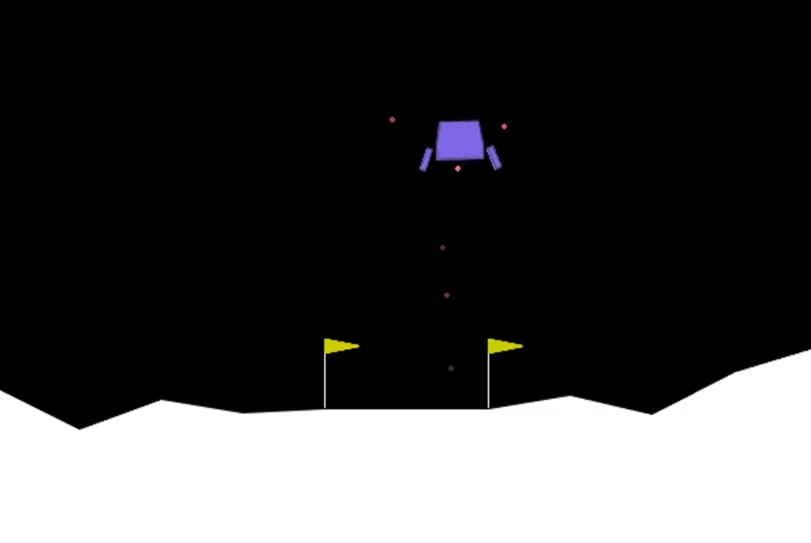

# RewardLab - Reinforcement Learning Experiments for Lunar Lander

RewardLab is an experimental reinforcement-learning project built around **Gymnasium `LunarLander-v3`** and **Proximal Policy Optimization (PPO)** from Stable-Baselines3. The project investigates whether reward shaping or conservative fine-tuning can improve a trained lander's performance.

The main finding so far is straightforward: **the baseline PPO policy is already strong, reward-shaping experiments substantially underperformed, and conservative fine-tuning produced a small improvement in mean reward but no improvement in the measured success rate.** The fine-tuning result is promising, not conclusive.

## Project goals

1. Establish a reliable PPO baseline on the standard LunarLander task.
2. Test whether additional reward signals help the policy learn more useful landing behaviour.
3. Test whether continued training from a good policy can improve it without destroying existing performance.
4. Compare all candidate checkpoints under a common evaluation protocol, using the **original, unmodified environment reward**.
5. Save per-episode data and record separate demonstration videos for each available model.

This is an empirical project. The experiments below are reported as they actually performed; unsuccessful approaches are retained as useful negative results rather than described as successful improvements.



## Environment and metrics

### Environment

- **Environment:** Gymnasium `LunarLander-v3`
- **Task:** control a lander to reach the landing area safely.
- **Observation:** 8 values, including position, velocity, angle, angular velocity, and leg-contact indicators.
- **Actions:** the environment's discrete engine-control actions.
- **Policy:** PPO with an `MlpPolicy`.
- **Evaluation action selection:** deterministic (`model.predict(..., deterministic=True)`).
- **Evaluation reward:** the original Gymnasium environment reward, even for policies trained with reward shaping.
- **Success proxy:** episode reward **>= 200**.

The `>= 200` threshold is an operational benchmark used by this project. It is **not** a direct, independently verified physical-safe-landing test. The final-validation script also records final position, velocity, angle, and leg contacts to support later, more explicit landing analysis.

### Metrics

| Metric | Meaning |
|---|---|
| Mean reward | Average total environment reward per episode. Higher is better. |
| Reward standard deviation | Episode-to-episode variability. Lower can indicate more consistent outcomes, but must be interpreted with mean reward. |
| Median reward | Middle episode reward; less sensitive to extreme episodes than the mean. |
| Minimum / maximum reward | Worst and best observed episodes in the evaluation set. |
| Success rate | Percentage of episodes with reward >= 200. |
| Episodes below 0 | Count of episodes with negative reward; a useful failure indicator in this comparison. |
| Mean episode length | Average number of environment steps per episode. Shorter is not automatically better: a short episode may be a crash, while a long episode may indicate inefficient control. |
| Paired reward difference | Candidate reward minus baseline reward on the same environment seed. |
| Bootstrap 95% confidence interval | Estimated uncertainty around the paired mean reward difference, using bootstrap resampling of matched episodes. |

### Baseline PPO configuration

The baseline training setup documented in the project uses:

| Hyperparameter | Value |
|---|---:|
| Algorithm | PPO |
| Policy | `MlpPolicy` |
| Hidden layers | `[64, 64]` |
| Learning rate | `3e-4` |
| `n_steps` | `1024` |
| `batch_size` | `64` |
| `n_epochs` | `10` |
| `gamma` | `0.99` |
| `gae_lambda` | `0.95` |
| `clip_range` | `0.2` |
| Seed | `42` |
| Original baseline training budget | 300,000 timesteps (project history) |


## Experiment summary

The main comparison run evaluated each of seven checkpoints for **100 episodes**, using seeds **1001–1100** and deterministic actions. All models were evaluated in the original `LunarLander-v3` environment. Results below are from `results/evaluations/run_20261026_211422/model_comparison.csv`.

| Model / checkpoint | Episodes | Mean reward | Std. dev. | Median | Min | Max | Episodes >= 200 | Success rate | Episodes < 0 | Mean steps |
|---|---:|---:|---:|---:|---:|---:|---:|---:|---:|---:|
| **Baseline PPO** | 100 | **238.99** | 48.52 | 251.64 | 10.25 | 294.82 | 91/100 | **91%** | 0 | 374.35 |
| Time Penalty | 100 | 33.86 | 130.57 | -39.54 | -182.43 | 232.62 | 13/100 | 13% | 53 | 529.62 |
| Hover Bonus | 100 | -89.78 | 41.23 | -89.04 | -341.48 | -15.63 | 0/100 | 0% | 100 | 966.05 |
| Progress | 100 | 27.67 | 128.63 | 79.98 | -217.73 | 214.58 | 1/100 | 1% | 44 | 609.04 |
| Potential Shaping | 100 | 7.32 | 77.81 | -8.97 | -140.48 | 178.64 | 0/100 | 0% | 64 | 862.31 |
| Fine-tuned PPO — Best | 100 | 238.52 | 58.56 | 256.25 | 23.25 | 294.14 | 87/100 | 87% | 0 | 349.36 |
| **Fine-tuned PPO — Final** | 100 | **242.44** | 49.07 | 253.42 | 12.12 | 292.09 | **93/100** | **93%** | 0 | 339.73 |

**Initial takeaway:** the baseline is a strong reference point. Of the seven checkpoints in this run, the final fine-tuned policy has the highest mean reward and success rate, but the separate 300-episode validation is needed to judge whether the improvement is robust. All four reward-shaping variants and both curriculum checkpoints were substantially worse than baseline.

## Experiments in detail

### 1. Baseline PPO - reference model

**Purpose:** establish a competent control policy and a fair reference for later experiments.

**Method:** PPO trained on the standard LunarLander task with the original reward. The baseline checkpoint is `models/best/best_model.zip`.

**Result in the 100-episode comparison:**

- Mean reward: **238.99**
- Standard deviation: **48.52**
- Median reward: **251.64**
- Success proxy: **91/100 (91%)**
- Negative-reward episodes: **0**
- Mean episode length: **374.35 steps**

**Interpretation:** this model is already strong. Any proposed experiment must be compared against this policy, not against a random agent. Because baseline performance is high, improvements are likely to be modest and should be assessed across many matched seeds.

### 2. Time-penalty reward shaping

**Purpose / hypothesis:** penalize each time step to encourage the lander to finish the task more efficiently rather than remain airborne unnecessarily.

**Implementation:** the wrapper adds `-0.05` to the original environment reward on every step. The shaping experiment is trained from scratch for the script's default **100,000 timesteps**, with the common PPO settings and seed 42.

**Result:**

- Mean reward: **33.86**
- Standard deviation: **130.57**
- Median reward: **-39.54**
- Success proxy: **13/100 (13%)**
- Negative-reward episodes: **53**
- Mean episode length: **529.62 steps**

**Interpretation:** the time penalty did not produce a competitive controller. The policy may have been pushed toward ending episodes quickly without learning how to land safely. A time cost is not inherently wrong, but its magnitude and interaction with the task reward matter; it should not be assumed to improve efficiency just because it penalizes time.

### 3. Hover-bonus reward shaping

**Purpose / hypothesis:** reward a stable, nearly motionless and upright lander, as a crude proxy for controlled flight.

**Implementation:** adds `+1.0` per step when `abs(angle) < 0.1`, `abs(vx) < 0.1`, `abs(vy) < 0.1`, and the episode has not terminated. Trained from scratch for the default 100,000 timesteps.

**Result:**

- Mean reward: **-89.78**
- Standard deviation: **41.23**
- Median reward: **-89.04**
- Success proxy: **0/100 (0%)**
- Negative-reward episodes: **100**
- Mean episode length: **966.05 steps**

**Interpretation:** this was the weakest reward-shaping result by success rate, and episodes were very long on average. The reward condition can incentivize staying in a low-velocity hover state instead of completing the landing task. The bonus is therefore a poor proxy for the actual objective in this form. Future designs should reward progress toward a valid landing state and make terminal outcomes central to the objective.

### 4. Progress reward shaping

**Purpose / hypothesis:** give the policy a denser signal when it moves closer to a target, rather than waiting for the environment's sparse task outcome.

**Implementation as currently coded:** adds the change in distance between consecutive observations, scaled by `1.0`. The distance is calculated as `sqrt(x**2 + y**2)` from the first two observation values. **Important limitation:** this is distance from the observation-space origin, not a carefully defined distance to the landing pad or a safe landing state.

**Result:**

- Mean reward: **27.67**
- Standard deviation: **128.63**
- Median reward: **79.98**
- Success proxy: **1/100 (1%)**
- Negative-reward episodes: **44**
- Mean episode length: **609.04 steps**

**Interpretation:** the result does not support the current implementation. Moving closer to the coordinate origin is not equivalent to moving toward a safe landing, and the signal does not explicitly account for horizontal landing-zone alignment, speed, orientation, or touchdown quality. This is a useful negative result and a clear implementation lesson: define the target geometry and the desired landing state before designing a progress reward.

### 5. Potential-based reward shaping

**Purpose / hypothesis:** use a state potential that assigns higher values to states that appear closer, slower, more upright, and less rotationally unstable. Potential-based shaping is theoretically attractive because, under the appropriate formulation and assumptions, it can add learning guidance while preserving the optimal policy.

**Implementation as currently coded:** the potential is

`Phi(s) = -(0.5 * distance + 0.3 * speed + 0.2 * abs(angle) + 0.05 * abs(angular_velocity))`

where `distance = sqrt(x² + y²)` and `speed = sqrt(vx² + vy²)`. The wrapper adds `0.1 * (gamma * Phi(next_state) - Phi(previous_state))`, with `gamma = 0.99`, and sets the next potential to zero on true termination.

**Result:**

- Mean reward: **7.32**
- Standard deviation: **77.81**
- Median reward: **-8.97**
- Success proxy: **0/100 (0%)**
- Negative-reward episodes: **64**
- Mean episode length: **862.31 steps**

**Interpretation:** the implemented version did not work well empirically. A key theoretical caveat is that the policy-invariance result applies to the potential-shaping construction under its assumptions; it does not guarantee that every practical implementation or finite training run will improve learning. The current potential uses distance from the coordinate origin rather than a target-aware landing-state potential, and the experiment trains from scratch. The result should be described as a failed implementation/experiment, not as evidence that potential-based shaping itself is invalid.

### 6. Conservative PPO fine-tuning - best checkpoint

**Purpose:** test whether continuing training from the already capable baseline can make small improvements without the instability that might come from a large update.

**Method:**

- Load the baseline PPO checkpoint rather than training from scratch.
- Preserve the original LunarLander reward.
- Continue for **100,000 additional timesteps**.
- Reduce the learning rate to **`1e-5`** (from the baseline's `3e-4`).
- Evaluate every **5,000** timesteps on **20 episodes**, deterministically, in the original environment.
- Save the best checkpoint observed by the evaluation callback.

**Result in the nine-model comparison:**

- Mean reward: **238.52**
- Standard deviation: **58.56**
- Median reward: **256.25**
- Success proxy: **87/100 (87%)**
- Negative-reward episodes: **0**
- Mean episode length: **349.36 steps**

**Interpretation:** the best checkpoint selected during training did not outperform the baseline on this 100-episode comparison: mean reward was slightly lower, success rate fell from 91% to 87%, and variability was higher. “Best” means best according to the callback's evaluation history, not necessarily better than the original baseline under every later seed set.

### 7. Conservative PPO fine-tuning - final checkpoint

**Purpose:** evaluate the policy at the end of the 100,000-step fine-tuning run, separately from the callback-selected best checkpoint.

**Method:** same fine-tuning run as above, but use the final saved policy rather than the best intermediate checkpoint.

**Result in the nine-model comparison:**

- Mean reward: **242.44**
- Standard deviation: **49.07**
- Median reward: **253.42**
- Success proxy: **93/100 (93%)**
- Negative-reward episodes: **0**
- Mean episode length: **339.73 steps**

**Interpretation:** in the first 100-episode comparison, the final fine-tuned checkpoint improved mean reward by about **3.45 points** over baseline (242.44 − 238.99) and success rate by **2 percentage points** (93% − 91%). This is a modest difference, so it was tested again on 300 matched episodes.

## Final validation: baseline vs fine-tuning

Because the initial comparison suggested a small advantage for fine-tuning, the project ran a more rigorous validation using **300 episodes per model** across three separate seed sets. Both models were tested on the same seed in each matched pair.

- **Set 1:** seeds 2001–2100
- **Set 2:** seeds 3001–3100
- **Set 3:** seeds 4001–4100
- **Total:** 600 episodes (300 per model)
- **Action selection:** deterministic
- **Environment:** standard `LunarLander-v3`
- **Success proxy:** reward >= 200
- **Output:** `results/final_validation/20261026_215209/`

### Overall results

| Metric | Baseline PPO | Fine-tuned PPO — Final | Difference (fine-tuned minus baseline) |
|---|---:|---:|---:|
| Episodes | 300 | 300 | — |
| Mean reward | 241.36 | **244.48** | **+3.12** |
| Standard deviation | 49.30 | 45.34 | -3.95 |
| Median reward | 251.80 | 254.23 | +2.43 |
| Minimum reward | -13.47 | -11.00 | +2.47 |
| Maximum reward | 299.88 | 301.44 | +1.56 |
| Successes (reward >= 200) | 279/300 | 279/300 | 0 |
| Success rate | **93%** | **93%** | **0 percentage points** |
| Mean episode length | 356.44 | **333.83** | -22.61 steps |

### Results by seed set

| Seed set | Baseline mean reward | Fine-tuned mean reward | Baseline success rate | Fine-tuned success rate |
|---|---:|---:|---:|---:|
| Set 1 (2001–2100) | 235.82 | 242.39 | 89% | 92% |
| Set 2 (3001–3100) | 242.18 | 250.89 | 94% | 98% |
| Set 3 (4001–4100) | 246.09 | 240.16 | 96% | 89% |

The fine-tuned policy performed better on Sets 1 and 2, but worse on Set 3. This variation is important: the result is not uniformly better across the seed groups.


**Interpretation:** the fine-tuned model has a higher observed mean reward by approximately 3.12 points, a slightly lower reward standard deviation, and shorter average episodes. However, the 95% bootstrap confidence interval for the mean paired difference includes zero, and both models achieved exactly 93% under the project's success proxy. Therefore, the current evidence **does not establish a reliable improvement**. The most defensible conclusion is that conservative fine-tuning maintained baseline-level performance and may offer a small efficiency/reward benefit, but a clear success-rate gain has not been demonstrated.

Shorter episodes are not automatically proof of better landings; the current evaluation would need a predefined safe-landing criterion based on final state, leg contact, velocity, and angle to make that claim.

## Research background

These experiments are inspired by established reinforcement-learning ideas. The cited papers motivate the hypotheses; they do **not** imply that this project's implementations must succeed.

1. **Proximal Policy Optimization (PPO).** Schulman et al. (2017), *Proximal Policy Optimization Algorithms*. PPO uses a clipped policy objective to make multiple minibatch updates while discouraging excessively large policy changes. It is the base algorithm used throughout RewardLab.  
   Paper: https://arxiv.org/abs/1707.06347  
   Practical explanation: https://spinningup.openai.com/en/latest/algorithms/ppo.html

2. **Potential-based reward shaping.** Ng, Harada, and Russell (1999), *Policy Invariance Under Reward Transformations: Theory and Application to Reward Shaping*. The classic result motivates adding a shaping term based on the difference in state potential, commonly expressed as `F(s, s') = gamma * Phi(s') - Phi(s)`. Correct construction and assumptions matter; arbitrary extra rewards do not inherit the guarantee.  
   Paper record: https://people.eecs.berkeley.edu/~russell/papers/icml99-shaping.pdf


3. **Gymnasium LunarLander.** The benchmark provides the environment, observation/action interface, physics simulation, and reward signal used in the experiments.  
   Documentation: https://gymnasium.farama.org/environments/box2d/lunar_lander/

4. **Stable-Baselines3 PPO.** The library implementation used to train, save, load, and evaluate the PPO checkpoints.  
   Documentation: https://stable-baselines3.readthedocs.io/en/master/modules/ppo.html

### How the research maps to the project

| Research idea | Project implementation | What the results say |
|---|---|---|
| PPO as a stable policy-gradient baseline | Baseline and all PPO experiments | Strong baseline; use it as the comparison anchor. |
| Dense reward shaping can guide learning | Time penalty, hover bonus, progress | Current reward designs did not beat baseline. |
| Potential differences can shape reward | Potential wrapper | Current potential and training setup performed poorly; implementation needs review. |
| Small policy updates can preserve learned behaviour | Fine-tuning from baseline at `1e-5` | Preserved strong performance; improvement remains uncertain. |

## How to reproduce

Run commands from the **project root** (the folder containing `README.md`, `reward_wrapper.py`, and `experiments/`). On Windows, activate your virtual environment first.

### 1. Install dependencies

```bash
pip install -r requirements.txt
```

The requirements include `gymnasium[box2d]`, `stable-baselines3[extra]`, `pandas`, `matplotlib`, and `moviepy`.

### 2. Run a reward-shaping experiment

The reward experiment script defaults to 100,000 timesteps. Example:

```bash
python experiments/train_reward.py --reward time_penalty
python experiments/train_reward.py --reward hover_bonus
python experiments/train_reward.py --reward progress
python experiments/train_reward.py --reward potential
```

To specify the training budget explicitly:

```bash
python experiments/train_reward.py --reward potential --steps 100000
```

Each run saves its checkpoint under `models/experiments/<reward_name>/model.zip` and logs under `logs/experiments/<reward_name>/`.

### 3. Run conservative fine-tuning

```bash
python experiments/train_fine_tuned.py
```

This loads `models/best/best_model.zip`, continues for 100,000 timesteps with learning rate `1e-5`, and saves the best and final checkpoints under `models/fine_tuned/`.


### 4. Evaluate all available checkpoints

```bash
python evaluate_experiments.py
```

The script evaluates each configured model for 100 episodes, using seeds 1001–1100, and saves:
- `episode_results.csv` — one row per model and episode.
- `model_comparison.csv` — aggregate metrics for each checkpoint.
- `evaluation_metadata.json` — evaluation settings, paths, and software versions.

The script will report missing checkpoints rather than silently treating them as evaluated. Confirm the paths in `evaluate_experiments.py` match the checkpoint folders in your current checkout.

### 5. Run final paired validation

```bash
python final_validation.py
```

This compares baseline PPO and the final fine-tuned model across 300 matched seeds per model and writes episode-level results, summary metrics, metadata, and a paired bootstrap comparison to `results/final_validation/<timestamp>/`.

### 6. Record a separate video for each model

```bash
python record_all_models.py
```

The recording script is intended to save one video per available checkpoint under `videos/model_recordings/`. If a configured checkpoint is missing, that model cannot produce a video until its path is corrected or the checkpoint is restored.

## Project structure

```text
RewardLab/
├── README.md
├── requirements.txt
├── reward_wrapper.py
├── evaluate.py
├── evaluate_experiments.py
├── final_validation.py
├── record_all_models.py
├── experiments/
│   ├── train_reward.py
│   ├── train_fine_tuned.py
│   
├── models/
│   ├── best/best_model.zip
│   ├── experiments/
│   │   ├── time_penalty/model.zip
│   │   ├── hover_bonus/model.zip
│   │   ├── progress/model.zip
│   │   └── potential/model.zip
│   ├── fine_tuned/
│       ├── best/best_model.zip
│       └── final_model.zip
│    
├── logs/
└── results/
    ├── evaluations/
    └── final_validation/
```

This is a conceptual view of the main files; generated logs and result folders may contain timestamped subdirectories.

## Interpretation, limitations, and next steps

### What we can confidently say

- The baseline is strong: 91% success proxy in the first 100-episode comparison and 93% in the later 300-episode validation.
- The four current reward-shaping experiments did not outperform baseline.
- Fine-tuning preserved the baseline's performance and had a small positive mean-reward difference in final validation.
- The fine-tuned policy did **not** improve the measured success rate: both policies scored 93% across 300 episodes.
- The paired bootstrap interval `[-1.836, +8.178]` crosses zero, so the observed average reward gain is uncertain.

### What we should not claim

- Do not claim that fine-tuning has definitively improved the agent.
- Do not claim that the reward-shaping research ideas are invalid; only these implementations and training runs failed to improve results.
- Do not equate reward >= 200 with a guaranteed safe landing.
- Do not compare raw training rewards from shaped-reward runs as if they were directly comparable to original-environment evaluation rewards. The common evaluation script avoids this by scoring every model with the original environment reward.


## Citation and reproducibility note

The results in this README describe the supplied RewardLab archive and its saved result files, not a claim that the reported numbers are universal or guaranteed to reproduce exactly on every machine. Record package versions, checkpoints, evaluation seeds, and code revisions whenever a new run is made.
